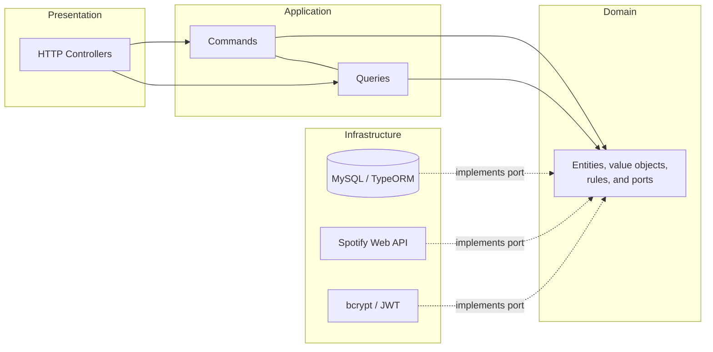

# Spotify Albums API

A REST API that, given an artist, returns albums ranked by popularity using the Spotify API, and stores each user’s search history.

This is version 2 of a 2022 project, rewritten to demonstrate hexagonal architecture, CQRS, strict TypeScript, and solid security practices. Decisions are documented in [`docs/adr`](docs/adr).

## Architecture



Dependencies always point inward to the domain. The domain imports neither NestJS, TypeORM, nor Spotify, and an ESLint rule enforces this.

```
src/
├── config/                 # Environment variable validation (zod)
├── shared/                 # Domain errors, clock, cache, exception filter
└── modules/
  ├── identity/           # Registration, login, current user
  │   ├── domain/         # User, Email, password policy, ports
    │   ├── application/    # RegisterUser, AuthenticateUser, GetCurrentUser
    │   ├── infrastructure/ # TypeORM, bcrypt, JWT
    │   └── presentation/   # AuthController, DTOs, guard
  └── music/              # Album search and history
    ├── domain/         # rankAlbumsByPopularity, SearchTerm, ports
        ├── application/    # GetArtistAlbums, RecordSearch, GetSearchHistory
    ├── infrastructure/ # Spotify adapter, search history repository
        └── presentation/   # MusicController
```

## Endpoints (`/api/v1`)

| Method | Route                     | Description                        | Auth |
| ------ | ------------------------- | ---------------------------------- | ---- |
| POST   | `/auth/register`          | Creates an account                 | No   |
| POST   | `/auth/login`             | Returns a 15-minute JWT            | No   |
| GET    | `/auth/me`                | Token user data                    | Yes  |
| GET    | `/artists/:artist/albums` | Artist albums ranked by popularity | Yes  |
| GET    | `/me/searches?limit=20`   | Latest user searches               | Yes  |
| GET    | `/health`                 | Service health                     | No   |

Interactive Swagger documentation is available at `/docs` outside production.

## How to run

```bash
cp .env.example .env        # set JWT_SECRET and Spotify credentials
docker compose up -d db
npm install
npm run migration:run
npm run start:dev
```

Tests: `npm test`. Tipos: `npm run typecheck`. Lint: `npm run lint`.

## What changed from version 1

| Before                                                             | Now                                                      | Why                                                               |
| ------------------------------------------------------------------ | -------------------------------------------------------- | ----------------------------------------------------------------- |
| `.env` with Spotify secret committed to the repo                   | `.env.example` without values and `.env` in `.gitignore` | A secret in a public repo is compromised                          |
| `secret: 'super-secret'` in code, non-expiring token               | Environment secret (min. 32 chars) and 15-minute expiry  | Anyone reading the repo could sign valid tokens                   |
| `POST /auth/getUser` issued a token for any email without password | JWT-protected `GET /auth/me`                             | It was a trivial identity spoof                                   |
| Services mixing HTTP, SQL, and rules                               | Separated layers with ports and adapters                 | Each piece is testable and replaceable independently              |
| Spotify token stored per user                                      | One in-memory application token, refreshed on expiry     | It is the same token for everyone; per-user storage made no sense |
| IP sent by browser and stored                                      | Removed                                                  | Unnecessary and forgeable personal data                           |
| `processData` selected the "first artist group"                    | Filters by searched artist                               | Previous version could return another artist’s albums             |
| No real tests                                                      | Domain and use-case tests with in-memory doubles         | Business logic is covered without a database                      |
